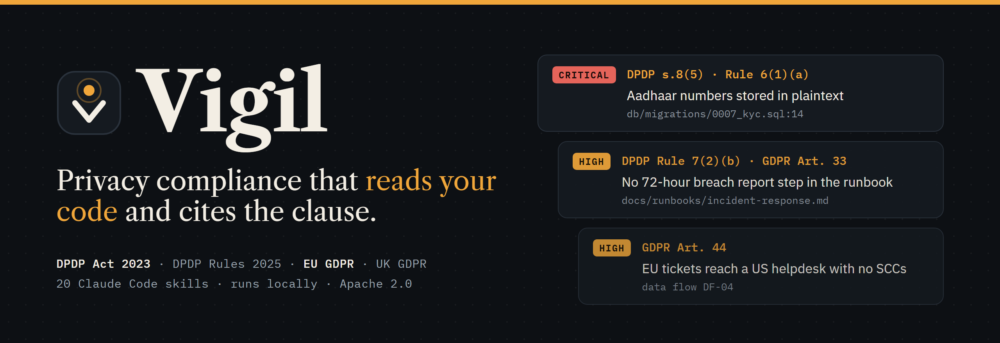
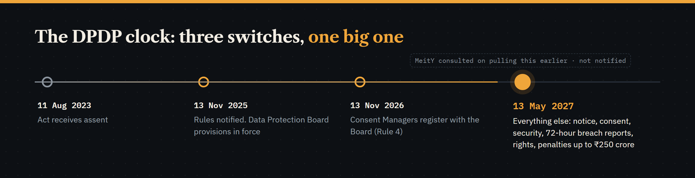
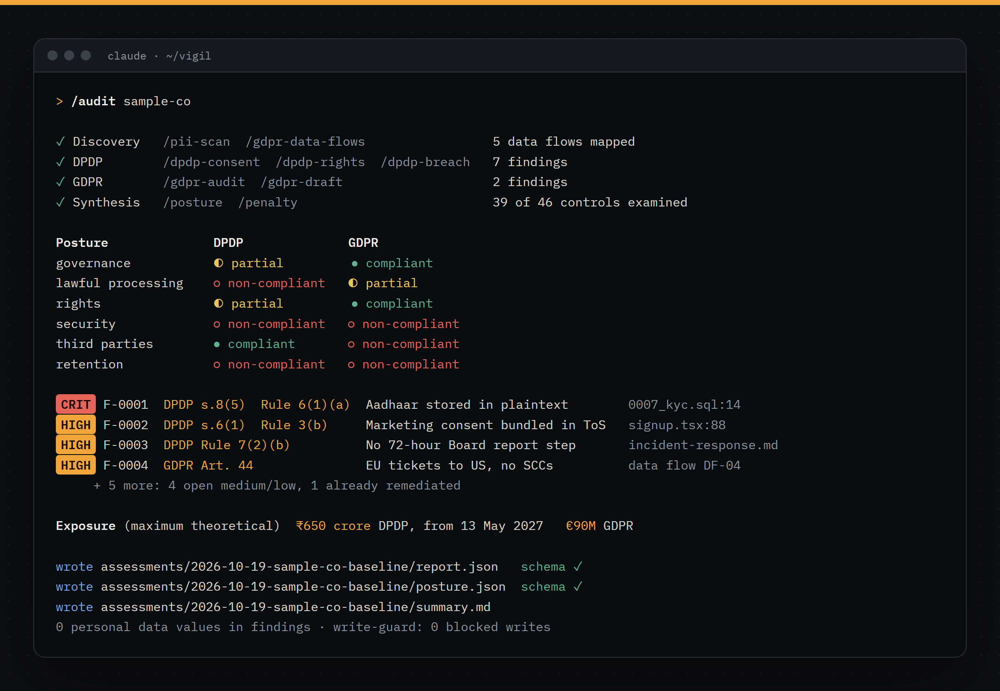
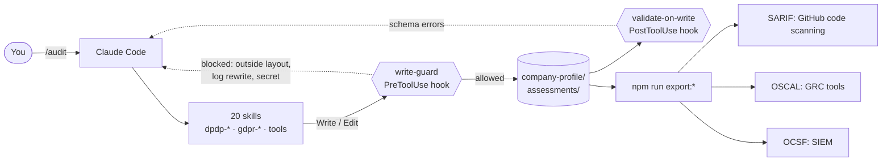

<p align="center">
  
</p>

<p align="center">
  <b>An open-source privacy compliance agent for India's DPDP Act and the EU/UK GDPR, built as 20 Claude Code skills.</b><br>
  It reads your code, schemas and data flows, writes findings that cite the exact section, rule or article, and exports them to GitHub code scanning.
</p>

<p align="center">
  <a href="https://github.com/prathikcannotcode/Vigil/actions/workflows/ci.yml"></a>
  <a href="LICENSE"></a>
  
  
  
  
</p>

<p align="center">
  <a href="#quick-start">Quick start</a> ·
  <a href="#what-a-run-looks-like">Sample output</a> ·
  <a href="#skills">Skills</a> ·
  <a href="#guardrails">Guardrails</a> ·
  <a href="#regulatory-coverage">Coverage</a> ·
  <a href="CONTRIBUTING.md">Contribute</a>
</p>

---

## The DPDP clock



India's Digital Personal Data Protection Rules switch on in stages. The Data Protection Board has existed on paper since November 2025. Consent Managers can register from 13 November 2026. On **13 May 2027** everything else lands at once: notices, consent, security safeguards, 72-hour breach reports, Data Principal rights, and penalties of up to ₹250 crore for a single failed safeguard. MeitY has already consulted on pulling that date forward.

A compliance checklist starts from the law and works down to the systems. Vigil starts from the other end: the code. It finds the Aadhaar column stored in plaintext, the marketing checkbox bundled into the terms, and the incident runbook with no 72-hour step. Each one comes back as a finding with a clause, a severity, a file and line, and a fix.

It won't tell you you're compliant. It will tell you which line of which file says you're not.

## What a run looks like



That picture is **sample-co**, a made-up lending app. Its files were written by hand to show the format, and no code ships for it, so `/audit sample-co` has nothing to scan:

- [`summary.md`](assessments/2026-10-19-sample-co-baseline/summary.md): the human-readable audit, with posture, findings, penalty arithmetic and a fix-first list
- [`report.json`](assessments/2026-10-19-sample-co-baseline/report.json): 9 schema-valid findings with owners, due dates and cross-references between DPDP and GDPR
- [`breach-log.jsonl`](company-profile/sample-co/breach-log.jsonl): an incident from detection to CERT-In (5h 25m) and the EU authority (44h 10m), one append-only line per step

To watch a real run, audit [`examples/acme-demo`](examples/acme-demo), a small synthetic app with planted problems, and score the result against [the list of what it should find](examples/acme-demo.expected.json). Quick start step 5 shows how. That list is also the place to start if you want to measure Vigil's accuracy; no benchmark results are published yet.

## Why Vigil

| | Spreadsheet checklist | Hosted privacy platform | **Vigil** |
|---|---|---|---|
| Looks at your code, schemas and logs | No | Usually through integrations | **Yes. It runs in your repo.** |
| Cites the DPDP section or rule per finding | If someone typed it in | Varies | **Every finding. The schema rejects one without a clause.** |
| Knows what is in force on which date | No | Varies | **Phased commencement table, checked before a gap is called a breach** |
| Where your data goes | Wherever the sheet lives | The vendor's cloud | **Your machine and your model provider. No Vigil server.** |
| Output | Cells | Dashboards | **JSON, Markdown, SARIF, OSCAL, OCSF** |
| Cost | Free | Licence fees | **Free (Apache 2.0), plus model usage** |

## Quick start

You need [Node.js 22+](https://nodejs.org) and [Claude Code](https://claude.com/claude-code). There is nothing to `npm install`.

1. **Clone and check the workspace.**
   ```bash
   git clone https://github.com/prathikcannotcode/Vigil.git
   cd Vigil
   npm run validate -- --strict
   ```
2. **Open Claude Code in the repo.**
   ```bash
   claude
   ```
3. **Look at the demo.** Type `/posture sample-co` or ask *"What's sample-co's penalty exposure?"*
4. **Add your organisation.** Type `/onboard` or say *"Add my company acme-tech, a SaaS company processing data in India and the EU."*
5. **Audit a codebase.** Add the codebase to the session (`/add-dir ../your-app`), then run `/audit`. Findings land in `assessments/`. To try it on the synthetic app first, copy it out of the repo so the run can't read the answer list, then add it the same way:
   ```bash
   cp -r examples/acme-demo ../acme-demo
   ```
6. **Send findings where your team already looks.**
   ```bash
   npm run export:sarif -- --company acme-tech --output findings.sarif
   ```
   Upload `findings.sarif` with [`github/codeql-action/upload-sarif`](https://docs.github.com/en/code-security/code-scanning/integrating-with-code-scanning/uploading-a-sarif-file-to-github) and findings with a file and line should appear in the Security tab next to your code. Findings with no file, such as a missing contract, and closed findings are left out of SARIF. The exporter names them, and they stay in `report.json`, OSCAL and OCSF.

Delete `company-profile/sample-co/` and `assessments/2026-10-19-sample-co-baseline/` whenever you like.

## Skills

Every skill is a real slash command. You can also describe the task in plain English and Claude picks the right one.

### Workflows

| Command | What it does |
|---|---|
| `/onboard` | Gathers organisation details, writes the company profile, detects which frameworks apply, takes a first posture snapshot |
| `/audit` | Full DPDP + GDPR audit in four phases: discovery, DPDP, GDPR, synthesis. `/audit dpdp` or `/audit gdpr` for one framework |
| `/remediate` | Turns findings into a plan ranked by penalty exposure, with owners, due dates and code fixes |
| `/refresh` | Quarterly re-assessment: regulatory changes, PII re-scan, data map drift, before/after posture |

### DPDP Act 2023 and Rules 2025

| Command | What it does | Anchored in |
|---|---|---|
| `/dpdp-consent` | Notices, valid consent, withdrawal, Consent Managers, dark-pattern review, parental consent | s.5, s.6, s.9; Rules 3, 4, 10 |
| `/dpdp-breach` | Assess, contain, notify the Board and every Data Principal, CERT-In and RBI in parallel | s.8(6); Rule 7 |
| `/dpdp-rights` | Access, correction, erasure, grievances (90-day ceiling), nomination, SLA tracking | ss.11-14; Rule 14 |
| `/dpdp-dpia` | Screening, full DPIA, annual review for Significant Data Fiduciaries | s.10(2)(c); Rule 13 |
| `/dpdp-dpo` | DPO charter, independence check, monitoring calendar, quarterly board report | s.10(2)(a), s.8(9); Rule 9 |
| `/dpdp-catalog` | Section and rule map, commencement dates, penalty Schedule, sector regulators | Act, Rules, RoD Order 2026 |

### EU GDPR and UK GDPR

| Command | What it does | Anchored in |
|---|---|---|
| `/gdpr-audit` | Code and system audit: personal data, lawful basis, minimisation, security, retention, transfers | Art. 5, 6, 9, 25, 32, 44-49 |
| `/gdpr-data-flows` | Data flow mapping and Record of Processing Activities check | Art. 30 |
| `/gdpr-draft` | Privacy notice, DPA, consent banner, retention policy, rights procedure | Art. 13-14, 28 |
| `/gdpr-qa` | Answers with article citations, recent CJEU and EDPB developments, UK divergence | Whole Regulation, DUAA 2025 |
| `/gdpr-catalog` | Article map, penalty tiers, transfer mechanisms, UK DUAA changes | Art. 83, 44-49 |

### Cross-framework tools

| Command | What it does |
|---|---|
| `/pii-scan` | Finds personal data in code, schemas, logs and configs, including Aadhaar, PAN and UPI IDs. Reports locations, never values |
| `/posture` | Six-dimension posture across DPDP and GDPR, saved as a snapshot |
| `/penalty` | Maximum exposure under the DPDP Schedule and GDPR Art. 83, with Art. 83(3) grouping so linked infringements are not double-counted |
| `/reg-monitor` | Upcoming dates, pending changes and their impact on you |
| `/export` | SARIF 2.1.0, OSCAL Assessment Results, OCSF Compliance Findings |

<details>
<summary><b>Prompts to try, by role</b></summary>

**Compliance officer**
- *What's our compliance posture?*
- *Which frameworks apply to acme-tech, and what are the penalty caps?*
- *Which DPDP obligations are in force today, and which start in May 2027?*

**Data Protection Officer**
- *Set up DPO governance for acme-tech.*
- *Prepare the quarterly board report.*
- *Has DPDP or GDPR changed anything that affects us?*

**Engineering**
- *Scan this codebase for personal data.*
- *Are there any dark patterns in our consent flow?*
- *Draft a fix for F-0003 and tell me which clause it closes.*

**Legal and privacy counsel**
- *Draft a GDPR privacy notice for our SaaS product.*
- *Is storing IP addresses in access logs GDPR compliant?*
- *Draft a Data Processing Agreement for our analytics vendor.*

**During an incident**
- *We've had a data breach. Walk me through the response.*

</details>

## How it works



Skills are Markdown that tell Claude what the law requires and how to check for it. Everything Claude writes passes through two hooks, and everything it writes must match a JSON Schema. The agent can be wrong about the law. It cannot quietly write a finding without a clause, rewrite a breach log, or drop a file outside the workspace.

## Guardrails

| Guard | Enforced by | What it stops |
|---|---|---|
| Workspace layout | `write-guard.mjs` reading [`layout.json`](.claude/schemas/layout.json) | Writes to any path the layout does not list, path traversal out of the repo, and edits to the hooks, schemas and settings themselves |
| Append-only logs | `write-guard.mjs` | Any write to `breach-log.jsonl` or `rights-log.jsonl` whose result does not start with the existing file. Corrections are new lines. |
| Schema validation | `validate-on-write.mjs`, `npm run validate` | A finding without a clause or severity, a breach entry without an event, a posture with an unknown status. 9 schemas. |
| Secrets | `write-guard.mjs` | AWS, GitHub, OpenAI and Anthropic-style keys, private keys, password assignments |
| No personal data in findings | `write-guard.mjs`, skill rules, schema shape | Aadhaar, PAN and +91 mobile numbers in company or assessment data. Findings carry `file` and `line`, never the value found there. Other identifiers rest on the skill rules. |
| Tests | `npm test`, GitHub Actions | Regressions in all of the above. 22 tests, Node's built-in runner. |

Known limit: hooks guard Claude Code's Write, Edit and MultiEdit tools. A shell command run through Bash is not intercepted, so `.claude/settings.json` only pre-approves the validate and test commands. Start Claude Code from the repo folder: a session that moves in from elsewhere cannot find the guard, and every write is blocked until you start a new one. Details in [SECURITY.md](SECURITY.md).

Your own company profiles and assessments are gitignored by default; only the synthetic demo is tracked. Use `git add -f` if you do want them in a private fork.

## Headless, CI and KPIs

Run a workflow without an interactive session, for example from a nightly job:

```bash
node .claude/scripts/run-headless.mjs --workflow audit --company acme-tech --framework dpdp --target ../your-app
```

`--target` is the codebase to read. Add `--dry-run` to print the prompt, or `--harness opencode --model <provider/model>` to run on OpenCode (no `--target` there, and the guardrail hooks are Claude Code settings, so don't assume they run). Every argument is validated before it reaches the shell, and the transcript lands in `kpis/data/raw/sessions/`, including a partial one if the run fails.

On a fresh clone, run `claude` once interactively and accept the trust dialog first. Until then Claude Code ignores the `permissions.allow` list in `.claude/settings.json`.

`npm run kpis` turns transcripts and each company's latest report into six numbers. Add `-- --company acme-tech` for one company; otherwise `sample-co` is pooled with yours until you delete it.

| KPI | Source | On sample-co |
|---|---|---|
| Cost per audit | `total_cost_usd` from Claude Code's JSON output | no runs recorded yet |
| Coverage | examined / applicable controls in each report, as counted by the assessor | 84.8% |
| Actionability | findings with clause, recommendation, owner and due date | 33.3% |
| Time to remediation | `remediated_at` minus `found_at`, median and p90 | 5 days |
| Posture trend | dimensions improved or regressed between snapshots | 1 snapshot |
| Penalty exposure trend | exposure per snapshot | ₹650 crore, €90M |

## Regulatory coverage

Last verified **2 November 2026**. Dates and clauses trace to the Gazette of India, EUR-Lex and legislation.gov.uk; see [`/dpdp-catalog`](.claude/skills/dpdp-catalog/SKILL.md) and [`/gdpr-catalog`](.claude/skills/gdpr-catalog/SKILL.md).

| Framework | What Vigil covers |
|---|---|
| DPDP Act 2023 | Sections 2-17, 27-33, 44, the penalty Schedule, the Removal of Difficulties Order 2026 |
| DPDP Rules 2025 | All 23 rules, with their phased commencement dates (13 Nov 2025, 13 Nov 2026, 13 May 2027) |
| EU GDPR | Principles, lawful bases, rights, controller and processor duties, breaches, DPIAs, transfers, Art. 83 penalties, recent CJEU and EDPB developments |
| UK GDPR + DUAA 2025 | Recognised legitimate interests, Art. 22A-22D, the transfer "data protection test", complaints handling, PECR changes |
| Indian sector rules | CERT-In Directions 2022, RBI Cybersecurity Directions 2026, SEBI CSCRF, IRDAI guidelines, CCPA Dark Patterns Guidelines 2023 |

Plus 7 consent notice templates (including Hindi) in [`examples/consent-notices`](examples/consent-notices) and sector guides for [fintech](examples/sector-guides/fintech-banking.md), [healthtech](examples/sector-guides/healthtech-healthcare.md) and [edtech](examples/sector-guides/edtech-education.md).

## What's in the repo

| Path | Purpose |
|---|---|
| `.claude/skills/<name>/SKILL.md` | The 20 skills |
| `.claude/schemas/` | 9 JSON Schemas and `layout.json`, the list of writable paths |
| `.claude/scripts/` | Hooks, validator, exporters, KPIs, headless runner, tests |
| `company-profile/{id}/` | Per-organisation data: details, data map, consent records, DPIAs, logs, posture |
| `assessments/{id}/` | Point-in-time audits: report, posture, summary |
| `examples/` | Consent notice templates, sector guides and a synthetic app to audit |
| `docs/assets/` | README images, logo, [brand sheet](docs/assets/brand-sheet.png) and [design tokens](docs/assets/vigil-tokens.css) |

## FAQ

**Does my data leave my machine?** Vigil has no server and no telemetry. Claude Code sends the files it reads to your model provider, as it does on any repo, so point it at the same code you would let a coding agent read.

**Why audit before May 2027?** Because fixing a plaintext Aadhaar column is a migration today and an incident report later. Before the main commencement date, Vigil labels DPDP gaps as readiness findings instead of violations.

**Is this legal advice?** No. It is tooling that shows its working: every finding names the clause so a lawyer can check it in minutes rather than rebuild it from scratch.

**Can I add another framework?** Yes. Add `<prefix>-*` skills and a catalog skill; [CONTRIBUTING.md](CONTRIBUTING.md) has the shape.

## Contributing

Regulatory updates, sector guides and notices in more Eighth Schedule languages are the most useful contributions. Read [CONTRIBUTING.md](CONTRIBUTING.md), then [AGENTS.md](AGENTS.md), which binds human and AI contributors alike. Report vulnerabilities through [SECURITY.md](SECURITY.md). Changes are listed in [CHANGELOG.md](CHANGELOG.md).

## Disclaimer

Vigil provides compliance tooling and informational guidance. It does not constitute legal advice. Verify current requirements against official sources and consult qualified counsel for binding compliance decisions.

## License

[Apache License 2.0](LICENSE).
